  

 

&nbsp;

&nbsp;

&nbsp;

&nbsp;

---

### 🔴 Identity & Engineering Focus

I am **Muhammed Ajmal U K**, an **AI/ML Engineer**, **Full-Stack Developer**, and **Creative Technologist**. I am the Founder & Lead Engineer at **[UTHAKKAN](https://www.uthakkan.in)** and a **Master of Computer Applications (MCA)** scholar at **College of Engineering Trivandrum (CET)**.

My engineering philosophy combines architectural rigor with fluid user experiences. I specialize in designing autonomous AI agent workflows, scalable cloud microservices, performant full-stack web platforms, and native-feel cross-platform mobile apps.

- 🎓 **Education:** Master of Computer Applications (MCA) @ **College of Engineering Trivandrum (CET)** *(APJ Abdul Kalam Technological University — 90.9%)*
- 🎓 **Undergraduate:** B.Sc. in Computer Science @ **Mahatma Gandhi College, Iritty** *(Kannur University — 89.7%)*
- 🏢 **Venture:** Founder & Lead Engineer at **[UTHAKKAN](https://www.uthakkan.in)** (Independent Software Studio & Digital Products)
- 🧠 **Core Specializations:** Autonomous AI Agents, Prompt Engineering, LLM Integration, Cloud Microservices, Cross-Platform Architecture
- 📍 **Location:** Kerala, India
- 🤝 **Collaboration:** Open to high-impact AI/ML engineering roles, architectural advisory, and technical partnerships

---

### 🏆 Verified Achievements & Track Record

Key milestones verified through production deployments and certified competitive performance:

- 🚀 **Organic Scale with ToolPix:** Architected and launched **[ToolPix](https://toolpix.pythonanywhere.com)**, generating over **600K+ organic Google Search clicks** and **14M+ search impressions** through algorithmic search optimization and responsive AI tool design.
- 📱 **Google Play Store Publisher:** Shipped **[KallanCop](https://play.google.com/store/apps/details?id=com.ajmal.kallancop)**, managing end-to-end game architecture, local Wi-Fi / hotspot multiplayer synchronization, and release lifecycles.
- ☁️ **Google Cloud Arcade Champion Tier:** Completed advanced Google Cloud infrastructure, security, and GenAI labs, earning Milestone 3 Certificate of Appreciation.

---

### 📜 Verified Industry Certifications

Every credential listed below is verified against official issuing authorities, verifiable codes, and local repository assets in [`assets/certificates/`](assets/certificates):

<table>
  <!-- Row 1: Oracle Certifications -->
  <tr>
    <td width="50%" valign="top">
      
        
      
       
      <b>Oracle Fusion AI Agent Studio Certified Foundations Associate — Rel 1</b> 
      <b>Domain:</b> Autonomous AI Agents, Studio Tooling, Multi-Agent Orchestration
        
      
    </td>
    <td width="50%" valign="top">
      
        
      
       
      <b>Oracle Cloud Infrastructure 2025 Certified AI Foundations Associate</b> 
      <b>Validity:</b> Through Oct 23, 2027 &nbsp;|&nbsp; <b>Domain:</b> OCI AI Services, Machine Learning
        
      
    </td>
  </tr>
  <!-- Row 2: Google Cloud & Microsoft -->
  <tr>
    <td width="50%" valign="top">
      
        
      
       
      <b>Google Cloud Arcade Facilitator Program 2025 (Cohort 2)</b> 
      <b>Recognition:</b> Milestone 3 Certificate of Appreciation &nbsp;|&nbsp; <b>Domain:</b> Cloud &amp; Gen AI
        
      
    </td>
    <td width="50%" valign="top">
      
        
      
       
      <b>Introduction to Prompt Engineering with GitHub Copilot</b> 
      <b>Date:</b> Oct 29, 2025 &nbsp;|&nbsp; <b>Credential ID:</b> <code>9264392</code> &nbsp;|&nbsp; <b>Domain:</b> Prompt Optimization
        
      
    </td>
  </tr>
  <!-- Row 3: IBM & Deloitte -->
  <tr>
    <td width="50%" valign="top">
      
        
      
       
      <b>IBM Introduction to Software Engineering</b> 
      <b>Date:</b> Nov 15, 2025 &nbsp;|&nbsp; <b>Domain:</b> SDLC, Software Architecture &amp; Agile Engineering
        
      
      &nbsp;
      
    </td>
    <td width="50%" valign="top">
      
        
      
       
      <b>Deloitte Data Analytics Job Simulation</b> 
      <b>Date:</b> Nov 1, 2025 &nbsp;|&nbsp; <b>Domain:</b> Forensic Technology, Analytics &amp; Case Execution
        
      
    </td>
  </tr>
  <!-- Row 4: GUVI & Verified Credential Archive Card -->
  <tr>
    <td width="50%" valign="top">
      
        
      
       
      <b>Generative AI 101 — Build the AI Edge for 2026</b> 
      <b>Issuer:</b> GUVI &amp; HCL &nbsp;|&nbsp; <b>Date:</b> Oct 30, 2025 &nbsp;|&nbsp; <b>Domain:</b> LLM Integration &amp; Edge AI
        
      
    </td>
    <td width="50%" valign="top">
      
        
      
       
      <b>Continuous Professional Education &amp; Verified Archive</b> 
      7 Official industry certificates verified and archived inside the repository, covering AI Agents, OCI Cloud, Prompt Engineering, and Software Design.
        
      
    </td>
  </tr>
</table>

---

### 🧩 Featured Projects & Production Deployments

Production-grade digital products designed, engineered, and shipped to users:

<table>
  <tr>
    <th width="20%" align="center">Project</th>
    <th width="44%" align="center">Description &amp; System Capabilities</th>
    <th width="16%" align="center">Tech Stack</th>
    <th width="20%" align="center">Action</th>
  </tr>
  <tr>
    <td align="center">
      <b>ToolPix</b> 
      AI &amp; Creator Platform
    </td>
    <td>Intelligent web platform delivering smart media processing, AI utilities, online compilers, and developer productivity tools. Generated 600K+ organic search clicks.</td>
    <td align="center"><code>Python</code> <code>Flask</code> <code>Gemini API</code> <code>OCR Engines</code></td>
    <td align="center">
      
    </td>
  </tr>
  <tr>
    <td align="center">
      <b>KallanCop</b> 
      Mobile Multiplayer Game
    </td>
    <td>Local multiplayer social deduction mobile game with automated role assignment and dynamic pass-and-play state engine published on Google Play.</td>
    <td align="center"><code>Flutter</code> <code>Dart</code> <code>Android</code> <code>Local Wi-Fi</code></td>
    <td align="center">
      
    </td>
  </tr>
  <tr>
    <td align="center">
      <b>Dementia Memory Assistant</b> 
      AI Cognitive Support
    </td>
    <td>Cognitive-support mobile app for dementia patients and caregivers featuring DeepFace (ArcFace) facial recognition, real-time location tracking, and emergency alerts.</td>
    <td align="center"><code>Flutter</code> <code>Flask</code> <code>Firebase</code> <code>DeepFace</code></td>
    <td align="center">
      
    </td>
  </tr>
  <tr>
    <td align="center">
      <b>Explore Together</b> 
      Travel Companion Platform
    </td>
    <td>Cross-platform travel companion app helping solo travelers connect and match trips with real-time chat, media sharing, and push notifications.</td>
    <td align="center"><code>Flutter</code> <code>Firebase</code> <code>Cloudinary</code> <code>OneSignal</code></td>
    <td align="center">
      
    </td>
  </tr>
  <tr>
    <td align="center">
      <b>Personal Portfolio</b> 
      Digital Identity &amp; Work
    </td>
    <td>Personal web portfolio presenting architectural case studies, software systems, and interactive product demos.</td>
    <td align="center"><code>HTML5/CSS3</code> <code>JavaScript</code> <code>Responsive</code></td>
    <td align="center">
      
    </td>
  </tr>
  <tr>
    <td align="center">
      <b>UTHAKKAN</b> 
      Software Studio Brand
    </td>
    <td>Official web platform for my independent digital product venture, building tools and web applications.</td>
    <td align="center"><code>React.js</code> <code>Node.js</code> <code>Cloud Web</code></td>
    <td align="center">
      
    </td>
  </tr>
</table>

---

### 🛠️ Technical Capabilities & Stack

Skills verified through real-world software engineering, university research, and certified training:

<table>
  <tr>
    <td width="26%" align="center"><b>🔴 AI &amp; Cloud Systems</b></td>
    <td width="74%">
      <code>Autonomous AI Agents</code> &nbsp; <code>LLM Integration</code> &nbsp; <code>Prompt Engineering</code> &nbsp; <code>Oracle Cloud (OCI)</code> &nbsp; <code>Google Cloud</code> &nbsp; <code>Firebase</code> &nbsp; <code>DeepFace</code>
    </td>
  </tr>
  <tr>
    <td width="26%" align="center"><b>💻 Programming Languages</b></td>
    <td width="74%">
      <code>Python</code> &nbsp; <code>JavaScript (ES6+)</code> &nbsp; <code>Dart</code> &nbsp; <code>Java</code> &nbsp; <code>C / C++</code> &nbsp; <code>SQL (MySQL)</code> &nbsp; <code>HTML5 / CSS3</code>
    </td>
  </tr>
  <tr>
    <td width="26%" align="center"><b>📱 Frameworks &amp; Backends</b></td>
    <td width="74%">
      <code>Flutter</code> &nbsp; <code>Flask</code> &nbsp; <code>React.js</code> &nbsp; <code>Node.js</code> &nbsp; <code>Express</code> &nbsp; <code>REST APIs</code>
    </td>
  </tr>
  <tr>
    <td width="26%" align="center"><b>⚙️ Databases &amp; DevOps</b></td>
    <td width="74%">
      <code>MongoDB</code> &nbsp; <code>MySQL</code> &nbsp; <code>Supabase</code> &nbsp; <code>Firestore</code> &nbsp; <code>Git &amp; GitHub</code> &nbsp; <code>Linux</code> &nbsp; <code>VS Code</code> &nbsp; <code>Postman</code>
    </td>
  </tr>
</table>

 

---

### 📈 Contribution Heatmap

Live GitHub contribution telemetry rendered in electric neon red:

 

<i>Live 365-day commit telemetry recorded directly from GitHub</i>

---

### 📊 GitHub Analytics

Curated engineering metrics themed in obsidian noir (`#080102`), electric neon red (`#FF1E27`), and crisp white typography:

&nbsp;

  

---

### 🌐 Connect & Network

Let's discuss AI product development, software architecture, or engineering opportunities:

&nbsp;

&nbsp;

&nbsp;

&nbsp;

&nbsp;

  

 

  

